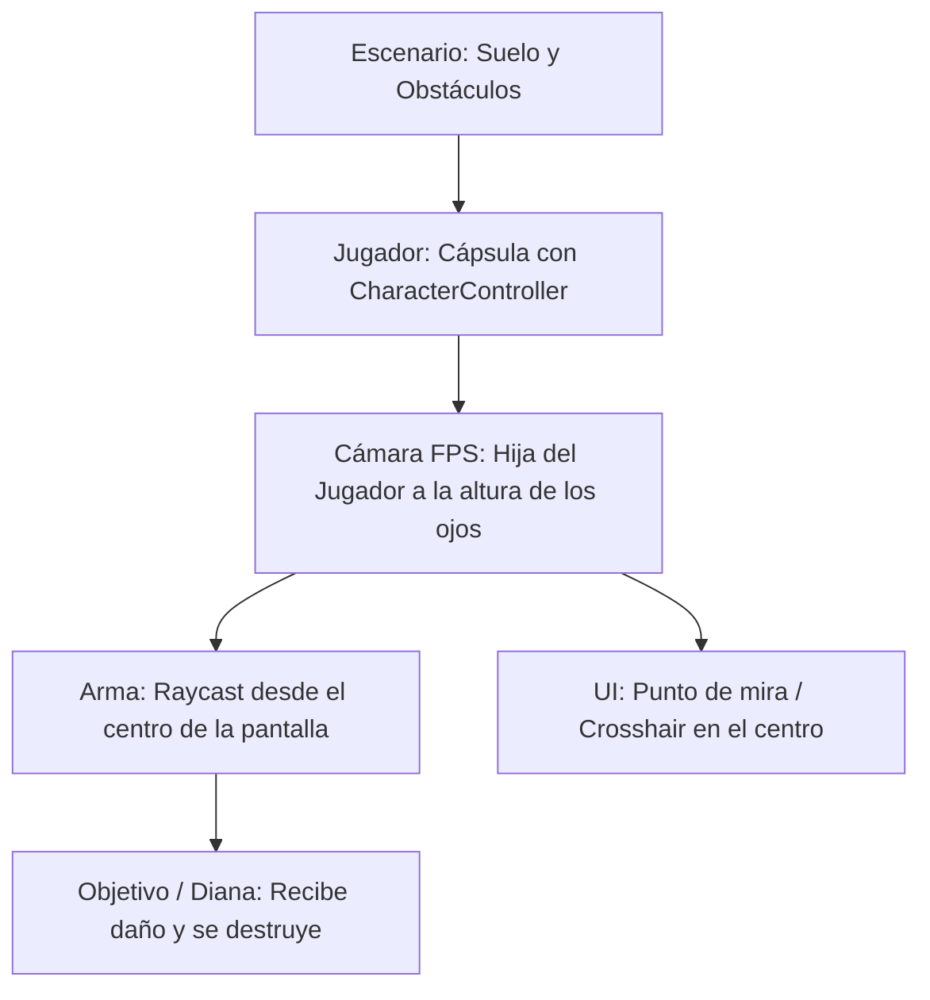

# 🎯 Roadmap Didáctico: Cómo Construir un Shooter 3D (FPS) en Unity

Esta guía está diseñada paso a paso para que puedas explicar a tus alumnos de forma interactiva, visual y divertida cómo funciona la arquitectura de un juego de disparos en primera persona.

---

## 🗺️ Visión General del Proyecto

---

## 📂 Archivos Creados en el Proyecto

Los scripts están listos en la carpeta `Assets/Scripts/`:
1. `PlayerMovement.cs` ➔ Gestiona WASD, correr (Shift), gravedad y salto (Espacio).
2. `MouseLook.cs` ➔ Gestiona la rotación del ratón (cabeza arriba/abajo, cuerpo izquierda/derecha).
3. `Weapon.cs` ➔ Lanza un rayo láser invisible (**Raycast**) al hacer clic izquierdo y detecta impactos.
4. `Target.cs` ➔ Otorga puntos de vida a los cubos/objetivos, haciéndolos parpadear en rojo y destruirse.

---

## 🚀 Sesión 1: "Construyendo el Mundo y el Personaje"

### Paso 1: El Escenario
1. En la pestaña **Hierarchy**, clic derecho ➔ `3D Object` ➔ `Plane` (Nombrarlo `Suelo`).
2. En el **Inspector**, asegurar que su posición sea `(0, 0, 0)` y su escala `(3, 1, 3)`.
3. Crear varios `3D Object` ➔ `Cube` para que sirvan de columnas y obstáculos.
4. *(Tip didáctico)*: Crear un Material de color oscuro o césped para el suelo y aplicarlo arrastrándolo.

### Paso 2: El Cuerpo del Jugador
1. Clic derecho en Hierarchy ➔ `3D Object` ➔ `Capsule` (Nombrarlo `Player`).
2. Posición inicial: `(0, 1.1, 0)`.
3. **Quitar** el componente `Capsule Collider` (Clic derecho sobre el componente ➔ `Remove Component`).
4. Añadir el componente `Character Controller` (`Add Component` ➔ `Character Controller`).
   * *Explicación a los alumnos*: El CharacterController ya calcula colisiones con paredes, pendientes y escaleras sin que el personaje ruede o se caiga de lado como una pelota.

### Paso 3: Los Ojos del Jugador (Cámara)
1. Busca la `Main Camera` en la Hierarchy y **arrástrala dentro de `Player`** para hacerla su hija.
2. Resetea la posición de `Main Camera` a `(0, 0.7, 0)`.
   * *Explicación a los alumnos*: La colocamos a 0.7 metros de altura respecto al centro de la cápsula para simular la altura de los ojos humanos.

---

## 🎮 Sesión 2: "Dándole Vida: Movimiento y Mirada"

### Paso 4: Mirar con el Ratón (`MouseLook.cs`)
1. Selecciona la `Main Camera`.
2. Arrastra el script `MouseLook.cs` a la cámara.
3. En el campo **Player Body**, arrastra el objeto padre `Player`.
4. *Puntos clave para explicar a los chicos*:
   * **Horizontal**: Cuando movemos el ratón a los lados, queremos que gire **todo el cuerpo**.
   * **Vertical**: Cuando miramos arriba o abajo, solo debe rotar **la cabeza** (la cámara), y usamos `Mathf.Clamp` con límites (-90° a 90°) para no desnucarnos haciendo giros de 360 grados como en El Exorcista.

### Paso 5: Moverse con WASD y Gravedad (`PlayerMovement.cs`)
1. Selecciona el objeto `Player`.
2. Arrastra el script `PlayerMovement.cs` al `Player`.
3. *Puntos clave para explicar*:
   * ¿Por qué usamos `Time.deltaTime`? Para que el juego vaya a la misma velocidad en una PC de la NASA que en una laptop de colegio.
   * `velocity.y`: Simulamos la gravedad real sumando aceleración constante cada frame.
   * Salto: Usamos la fórmula física $v = \sqrt{h \cdot -2 \cdot g}$.

> **¡Momento de Probar!** Presiona **Play**. Ya deberías poder moverte con WASD, saltar con Espacio, correr con Shift y mirar libremente con el ratón. (Presiona `Escape` si necesitas recuperar el cursor).

---

## 🔫 Sesión 3: "La Mecánica de Disparo (Raycasting)"

### Paso 6: ¿Qué es un Raycast? (Metáfora para los chicos)
* Imaginen un puntero láser que sale disparado en línea recta desde el centro de los ojos del jugador a la velocidad de la luz.
* Si el láser toca algo, Unity nos dice inmediatamente:
  1. ¿Qué objeto tocó? (`hit.transform.name`)
  2. ¿En qué punto exacto del espacio colisionó? (`hit.point`)
  3. ¿Hacia dónde apunta la pared impactada? (`hit.normal`)

### Paso 7: Configurar el Arma (`Weapon.cs`)
1. Crea un `3D Object` ➔ `Cube` dentro de `Main Camera`, cámbiale el tamaño a `(0.1, 0.1, 0.5)` y ponlo abajo a la derecha de la vista para que simule una pistola o cañón.
2. Selecciona la `Main Camera` (o el objeto del arma) y agrégale el script `Weapon.cs`.
3. En el campo `Fps Camera`, asigna la `Main Camera`.

---

## 🎯 Sesión 4: "Objetivos de Práctica y Daño"

### Paso 8: Crear Dianas u Objetivos (`Target.cs`)
1. Crea un cubo en el escenario y colócalo a unos metros frente al jugador.
2. Cámbiale el nombre a `Target_Dummy`.
3. Agrégale el script `Target.cs`.
4. Duplícalo (`Ctrl + D`) varias veces para crear una galería de tiro.
5. Si quieres que las cajas vuelen al ser disparadas, agrégales además un componente `Rigidbody`.
   * *¡El script de Weapon ya detecta si tienen Rigidbody y les aplica un empujón por impacto!*

---

## 🔴 Sesión 5: "Punto de Mira en Pantalla (Crosshair)"

Para que los chicos sepan exactamente a dónde están apuntando:
1. En Hierarchy: Clic derecho ➔ `UI` ➔ `Canvas`.
   * En el componente `Canvas Scaler`, seleccionar `Scale With Screen Size`.
2. Clic derecho en el Canvas ➔ `UI` ➔ `Image`.
3. Cambiarle el tamaño (Width: `8`, Height: `8`).
4. Ponerle color blanco o verde brillante.
5. Por defecto aparecerá justo en el centro de la pantalla. ¡Ese es el punto de mira!

---

## 🏆 Retos y Proyectos para los Alumnos (Gamificación)

Para motivar a los chicos a seguir experimentando tras la clase base:

- [ ] **Nivel Bronce (Cosmético)**: Crear materiales de colores chillones (neón, rojo, azul) y personalizar el arma y los cubos.
- [ ] **Nivel Plata (Efectos)**:
  * Crear un sistema de partículas simple (`GameObject ➔ Effects ➔ Particle System`) para el impacto de las balas y asignarlo en `impactEffect`.
  * Añadir un sonido de `Pew Pew` al disparar en `shootAudio`.
- [ ] **Nivel Oro (Gameplay)**:
  * Añadir un contador de "Blancos eliminados" en la pantalla usando `TextMeshPro`.
  * Crear un tipo de blanco "Rápido" (poca vida) y uno "Tanque" (mucha vida).
- [ ] **Nivel Diamante (IA Enemiga)**:
  * Hornear una malla de navegación (`NavMesh`) y crear un script básico para que los cubos persigan al jugador.
